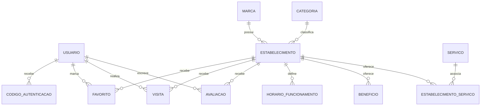

# Modelo de dados do WEG Benefits

Este documento consolida a modelagem enviada para orientar o domínio do Mobile. Ele define entidades, cardinalidades e regras que a interface deve respeitar. O Backend continua responsável pelo esquema físico, nomes e tipos finais das colunas, endpoints, payloads e regras de autenticação; este documento não substitui o contrato da API.

## Entidades e relacionamentos

`FAVORITO` materializa a relação muitos-para-muitos entre usuário e estabelecimento, com chave composta (`usuario_id`, `estabelecimento_id`). `ESTABELECIMENTO_SERVICO` materializa a relação muitos-para-muitos entre estabelecimentos e serviços, também com chave composta. Visitas e avaliações são eventos independentes e não decorrem de um favorito.

## Entidades

| Entidade | Atributos de domínio | Regras principais |
|---|---|---|
| `USUARIO` | `id`, `nome`, `email`, `ativo`, `criado_em`, `atualizado_em` | Nome com 6–75 caracteres; e-mail válido e único. Senha nunca é distribuída à interface nem armazenada em texto puro; o hash é responsabilidade exclusiva do servidor. |
| `CODIGO_AUTENTICACAO` | usuário relacionado e dados do código/validade | Um usuário pode possuir vários códigos. Armazenamento, expiração e validação são exclusivamente do Backend; detalhes físicos aguardam o contrato de autenticação. |
| `MARCA` | `id`, nome e estado ativo | Marca agrupa unidades físicas de estabelecimentos. |
| `CATEGORIA` | `id`, `nome`, `icone_id`, `cor_hex`, `ativo` | Nome com 6–75 caracteres; ícone escolhido do catálogo da aplicação e persistido pelo identificador; cor persistida como hexadecimal. |
| `ESTABELECIMENTO` | `id`, `marca_id`, `categoria_id`, nome, descrição, endereço, latitude, longitude, altitude, imagem da fachada, estado ativo | Unidade física. Nome com 2–75 caracteres; descrição com 50–300; rua, bairro, cidade e estado com 3–75. Guarda referências à marca e categoria. |
| `BENEFICIO` | `id`, `estabelecimento_id`, público, instruções de participação, contato, desconto, condições, estado ativo, criado/atualizado em | Um estabelecimento pode oferecer vários benefícios. Para a tela do MVP, o cliente pode destacar um benefício principal, sem alterar a relação de domínio. Instruções com 50–300 e condições com 10–300 caracteres. |
| `SERVICO` | `id`, `nome`, `ativo` | Nome único no sistema, com 3–75 caracteres. Serviços podem ser criados pelo fluxo administrativo quando não houver opção adequada. |
| `ESTABELECIMENTO_SERVICO` | `estabelecimento_id`, `servico_id` | Entidade de associação que permite vários serviços por estabelecimento e cada serviço em vários estabelecimentos. |
| `HORARIO_FUNCIONAMENTO` | `id`, `estabelecimento_id`, dia da semana, hora de abertura/fechamento e estado fechado | Um estabelecimento tem zero ou mais períodos. Os detalhes de intervalos, feriados e fuso horário devem seguir o contrato do Backend. |
| `FAVORITO` | `usuario_id`, `estabelecimento_id`, `favoritado_em` | Relação muitos-para-muitos; combinação usuário/estabelecimento é única. |
| `VISITA` | `id`, `usuario_id`, `estabelecimento_id`, `visitado_em` | Cada visita registrada relaciona exatamente um usuário e um estabelecimento. |
| `AVALIACAO` | `id`, `usuario_id`, `estabelecimento_id`, nota, comentário opcional, criado/atualizado em | Cada avaliação pertence a um usuário e estabelecimento. Escala, moderação e possibilidade de múltiplas avaliações aguardam definição do Backend. |

Todos os identificadores de entidade são inteiros no modelo conceitual. CEP permanece texto no domínio de apresentação para preservar zeros à esquerda e formatação; a conversão para o tipo físico do banco cabe ao Backend.

## Campos calculados para a interface

| Campo | Cálculo |
|---|---|
| `distance` | Distância entre a localização atual do usuário e latitude/longitude do estabelecimento. A posição do usuário é temporária. |
| `isFavorite` | Existência de `FAVORITO` para o usuário e estabelecimento atuais. |
| `isOpen` | Horários de funcionamento comparados com data e hora local aplicáveis. |
| `averageRating` | Média das notas de avaliação associadas ao estabelecimento. |

Esses valores são derivados e não devem ser tratados como atributos persistidos da entidade. A UI deve aceitar valor ausente quando o contrato não disponibilizar dados suficientes para calculá-los.

## Regras de integridade e uso no Mobile

- IDs de chaves estrangeiras devem apontar para entidades existentes e ativas conforme as regras do servidor.
- Ao excluir ou desativar registros, a política de integridade referencial pertence ao Backend; o Mobile não deve simular cascatas.
- Favoritos e visitas permanecem independentes.
- Serviços são uma relação N:N com estabelecimento; não salvar uma lista de nomes duplicada dentro da entidade estabelecimento.
- Benefícios pertencem ao estabelecimento. A descrição original menciona uma FK de benefício em estabelecimento, mas a cardinalidade explícita `ESTABELECIMENTO 1 — N BENEFICIO` determina a FK em `BENEFICIO`.
- Autenticação, hash de senha e códigos de autenticação não devem ser implementados ou persistidos pelo frontend.
- Coordenadas brutas do usuário não devem ser armazenadas como histórico. Dados de altitude do estabelecimento são metadados próprios do local.

## Tipos do domínio do cliente

Os tipos TypeScript em [`src/lib/domain.ts`](../src/lib/domain.ts) espelham os conceitos usados pela UI, sem fixar formato de JSON da API. Um adaptador de API deverá mapear o contrato oficial para estes tipos quando a especificação do Backend estiver disponível.
